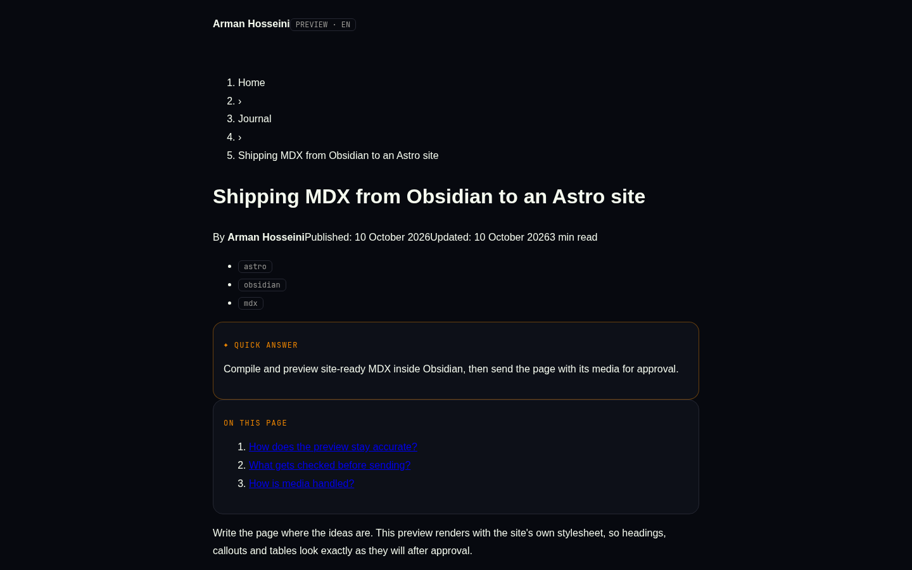

# Vergo MDX Studio

Write `.mdx` in Obsidian, see it **as it will look on the website**, compile it, and send the page together with its images/videos to the site — where it waits for **your approval** in the dashboard Inbox.



## Why

Authoring site-ready MDX by hand means juggling frontmatter, website-only components, Obsidian syntax and media that has to reach the server. Vergo MDX Studio moves that into the editor you already write in: an accurate preview, the same compiler the site runs, a pre-flight check, and a send-for-approval flow that never publishes anything on its own.

## Features

- **New MDX note** — right-click any folder in the file explorer (or run the command). Asks title + language, creates a `.mdx` with the right frontmatter and opens it. `.mdx` files open in the normal editor.
- **Website preview** — a side pane that renders the note with the site's own stylesheet (a copy is bundled so it is never unstyled; the live one is used when the site already runs the current design — setting *Preview styles*). RTL/LTR by `lang`, dark/light toggle, Quick-answer box, table of contents, FAQ, reading time. Updates as you type.
- **Compile** — the same MDX compiler the site uses (GFM on). Errors show file line/column with a plain-language hint. Website-only components render as placeholders; `import` lines are ignored for the preview only.
- **Checks** — title/summary length, missing alt text, H1 in body, FAQ/tags hints, missing media — the same kind of rules the dashboard's SEO health applies.
- **Send to website…** — asks language (`en`/`fa`), type (`journal`/`projects`) and slug, lists the media that will travel with the page, uploads only the images/videos the server lacks (hash-named), then submits. Nothing is live until you approve it in the dashboard Inbox.
- **Obsidian syntax conversion** — `![[img.png]]`, `![[clip.mp4]]`, `[[wikilinks]]`, `==highlight==`, `> [!callouts]`, `%%comments%%` and `^block-ids` are converted; fenced code blocks are left untouched.

## Requirements

- Obsidian `1.5.0` or newer (`manifest.json › minAppVersion`).
- A running site with the Studio API and a **Studio token** from its dashboard.
- For development: Node.js `22` or newer and npm.

## Install

1. Copy `main.js`, `manifest.json` and `styles.css` into
   `<vault>/.obsidian/plugins/vergo-mdx-studio/`.
2. In Obsidian, turn the plugin off and on again (or reload with `Ctrl+R`). The preview toolbar shows the running version (`v1.1.0`) — if it shows an older one, an old `main.js` is still loaded.
3. Open **Settings ▸ Vergo MDX Studio**: set the site URL and paste a token from the dashboard (Settings ▸ Studio tokens). **Test** checks the connection.

`main.js` is not committed — build it from source (below).

## Usage

| Command (Ctrl/Cmd-P) | What it does |
| --- | --- |
| `New MDX note` | Create a `.mdx` with frontmatter in the active folder. |
| `Open website preview` | Open the preview side pane. |
| `Compile this note` | Compile and report errors with line numbers. |
| `Send this note to the website (needs approval)` | Prepare and submit the page + media. |

The file-explorer context menu offers **New MDX note** on folders and **Preview MDX** / **Send to website…** on `.mdx` files.

## Configuration

All settings live in Obsidian (Settings ▸ Vergo MDX Studio); there are no environment variables. The token is stored on the device only.

| Setting | Purpose | Default |
| --- | --- | --- |
| Site URL | Base URL of the site the API runs on | `https://arman-hosseini.ir` |
| Token | Studio token used as a bearer token | *(empty)* |
| Default language | `en` or `fa` for new notes and sends | `fa` |
| Default type | `journal` or `projects` | `journal` |
| Preview styles | `auto` (live when current) or `bundled` | `auto` |
| Preview theme | `dark` or `light` | `dark` |

### Studio API used

`GET /api/studio/ping` · `POST /api/studio/media/check` · `PUT /api/studio/media?name=<hash>.<ext>` · `POST /api/studio/submissions`. The server compiles MDX again before storing anything (broken MDX → HTTP 422, nothing stored); the site build produces the final HTML after approval, and staged media is moved into `/media/studio/<hash>.<ext>` only when you approve.

## Architecture

- `src/main.ts` — plugin entry: view, commands, file-explorer menu, settings tab.
- `src/mdx/` — `frontmatter` (parse/set keys), `policy` (mirrors the server's rules), `compile` (MDX → DOM with a hint for every error), `runtime` + `components` (tiny JSX-to-DOM runtime and preview renderers for the site components), `checks` (SEO-health rules), `obsidianSyntax` (Obsidian → MDX).
- `src/preview/` — `previewView` (the `ItemView` with an iframe), `pageShell` (rebuilds the site's entry page), `siteCss` (live stylesheet with a bundled fallback).
- `src/publish/` — `client` (HTTP to the Studio API), `flow` (prepare + send), `media` (find, hash and rewrite media), `publishModal`.
- `src/settings.ts`, `src/newNote.ts` — settings shape and the new-note dialog.

```
src/
  main.ts          plugin entry + settings
  mdx/             compile, policy, checks, syntax, runtime, components
  preview/         preview view, page shell, site CSS
  publish/         client, flow, media, modal
  settings.ts
  newNote.ts
scripts/
  snapshot-css.mjs  refresh the bundled stylesheet from a site build
```

## Development

```bash
npm install      # install dependencies
npm run dev      # esbuild in watch mode -> main.js
npm run typecheck
npm test         # vitest run
npm run build    # tsc --noEmit + production bundle
```

Tests cover the MDX compile/runtime, Obsidian-syntax conversion, media hashing/rewriting and the full send flow. The Obsidian UI (modals, preview pane, menus) is type-checked but must be tried inside Obsidian.

To refresh the bundled stylesheet from a built copy of the website:

```bash
node scripts/snapshot-css.mjs ../arman-hosseini/dist
```

## Security

The plugin only talks to the site URL you configure, authenticated with your token. No page is published without approval, and media is staged server-side until then. Never commit your token; the repository is scanned for secrets before every release.

## Contributing

Issues and pull requests are welcome at
<https://github.com/vergoboy/vergo-mdx-studio>. Keep the dashboard policy and SEO rules in sync when the server changes.

## License

[MIT](LICENSE)
